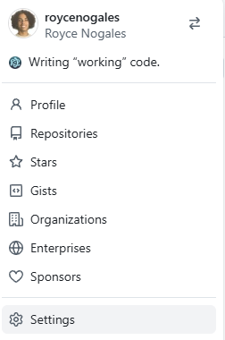
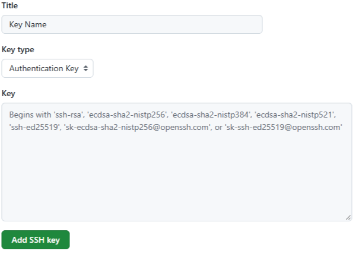

# How to Setup Powershell to access GitHub

## Steps
- Install Git
- Run ssh-agent
- Create SSH Key
- Add SSH Key to GitHub
- Who Are You?

## Install Git

```
winget install --id Git.Git -e --source winget
```

## Run ssh-agent

```
# Run Powershell as Administrator, then run these commands
Get-Service -Name ssh-agent | Set-Service -StartupType Manual
Get-Service ssh-agent | Select StartType
Start-Service ssh-agent

# Run this command to see if it says that it's Running
Get-Service ssh-agent
```

## Create SSH Key

```
# run this command
ssh-keygen -t ed25519 -C "your_email@example.com"
# Modify the names of the files if you wish, and press enter until the key is created.

# Add ssh key to ssh-agent
ssh-add c:/Users/YOU/.ssh/id_ed25519
```

## Add SSH Key to GitHub

Open GitHub and click on your profile picture.  


___

Then click 'Settings'.


___
In Settings, click on 'SSH and GPG Keys'.  


___
Click the button that says 'New SSH Key'.


___
In the field below, paste the contents of the public key you created, likely called id_ed25519.pub.  



## Who Are You?

GitHub doesn't yet know who you are, so we must specify.

```
git config --global user.email "you@example.com"
git config --global user.name "Your Name"
```

## All Done

You should now be able to access GitHub repositories and do things form within your terminal.

### References

[Git](https://git-scm.com/install/windows)

[SSH-AGENT](https://peateasea.de/starting-ssh-agent-in-windows-powershell/)

[SSH Key](https://docs.github.com/en/authentication/connecting-to-github-with-ssh/generating-a-new-ssh-key-and-adding-it-to-the-ssh-agent)
